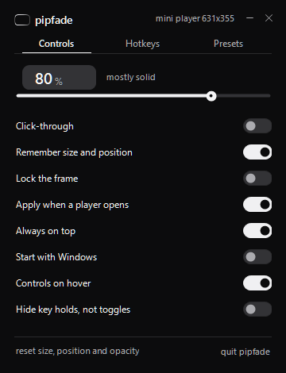
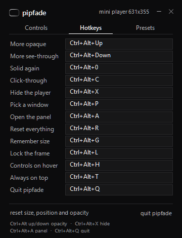
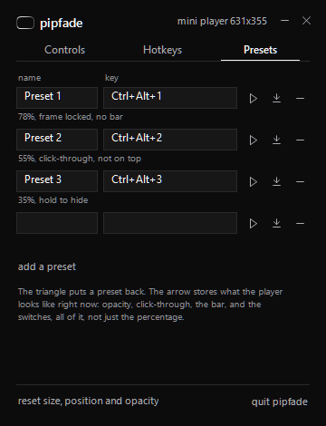

<div align="center">

<picture>
  <source media="(prefers-color-scheme: light)" srcset="docs/banner-light.svg">
  <source media="(prefers-color-scheme: dark)" srcset="docs/banner.svg">
  
</picture>

<br>

[](https://github.com/LvSpook/pipfade/releases)
[](https://github.com/LvSpook/pipfade/releases)
[](https://learn.microsoft.com/powershell/)
[](LICENSE)

**A see-through mini player for Brave, Chrome and Edge.**
Make the picture-in-picture window translucent, keep it out of the way, and have it
remember exactly how you left it.

[Download](#-download) · [Features](#-features) · [Hotkeys](#-default-hotkeys) · [Docs site](https://lvspook.github.io/pipfade/) · [AI disclosure](#-ai-assistance-disclosure)

</div>

---

> [!NOTE]
> **Why this is not a browser extension**
> The mini player is a native Windows window, not a web page. No extension or
> userscript can reach it — they can only touch web content. pipfade drives the
> window from Windows itself instead, which is why it is a small PowerShell script
> and not something you install into your browser.

---

## ✨ Features

<table>
<tr>
<td width="50%" valign="top">

**Opacity**

- Any level from 16% to fully solid
- Drag the slider, or click the percentage and type an exact number
- Applied automatically to every new mini player
- Your level is remembered between sessions

**Layout**

- Each player remembers its position, and its size when the video is the same shape
- Lock the frame so a stray drag cannot undo an arrangement
- Works with two players at once, each with its own layout
- Panel opens where you left it, always the same size

</td>
<td width="50%" valign="top">

**Without leaving the video**

- Hover bar inside the player: percentage, slider, four buttons
- Every gap on the bar is clickable, so a near miss is still a press
- Never takes focus, so the video keeps playing
- Click-through, so clicks reach the window behind
- Always on top, even over fullscreen games and video

**Set up your way**

- Thirteen rebindable hotkeys, recorded by pressing them
- Four presets, each holding every setting, each with its own shortcut
- A long binding or preset name left clipped says the rest of itself on hover
- Tray icon with a dark menu that matches the panel
- Starts with Windows, no console flash
- Costs nothing to leave running: under 0.7% of one core, and most seconds at zero
- Tells you when there is a newer version, with a link to the release notes

</td>
</tr>
</table>

## 📥 Download

| File | What it is |
| --- | --- |
| `pipfade.ps1` | The whole application. One file, no dependencies. |
| `Start pipfade.vbs` | Double-click this the first time. Starts with no console flash. |
| `Start pipfade.cmd` | The same thing in a console, if you would rather watch it start. |
| `Restore mini player.cmd` | Puts the player back to normal and clears every saved setting. |

Unpack anywhere and double-click **Start pipfade.vbs**. It starts quietly, leaves one
icon next to the clock, and writes **Start pipfade.lnk** next to itself on that first
run — a shortcut carrying the app's own icon, which is the one to use from then on.
A shortcut file has to be made on your own machine to point at your own folder, so it
is created there rather than shipped.

Windows SmartScreen may warn the first time because the files came from the internet.
`pipfade.ps1` is plain text and readable in any editor if you want to check it before
running it.

Nothing needs to be run as administrator.

## 🖼 What it looks like

<div align="center">





<br><br>


</div>

## ⌨️ Default hotkeys

These work at any time, even with the panel closed. Every one of them can be changed
or removed on the **Hotkeys** tab.

| Keys | Action |
| --- | --- |
| `Ctrl+Alt+Up` | More opaque |
| `Ctrl+Alt+Down` | More see-through |
| `Ctrl+Alt+0` | Solid again |
| `Ctrl+Alt+C` | Toggle click-through |
| `Ctrl+Alt+X` | Hide the player |
| `Ctrl+Alt+G` | Toggle remember size and position |
| `Ctrl+Alt+L` | Lock the frame where it is |
| `Ctrl+Alt+H` | Toggle the hover controls |
| `Ctrl+Alt+T` | Toggle always on top |
| `Ctrl+Alt+A` | Open the panel |
| `Ctrl+Alt+P` | Pick the window under the cursor, if detection ever misses |
| `Ctrl+Alt+R` | Reset everything |
| `Ctrl+Alt+Q` | Quit and restore the player |
| `Ctrl+Alt+1` … `Ctrl+Alt+4` | Apply a saved preset |

A key pressed without Ctrl or Alt is refused, because a bare letter would be swallowed
system-wide. Keypad digits cannot take Shift while NumLock is on: Windows turns that
into the arrow key before any program sees it, so the box says so instead of storing a
shortcut that would never fire.

## 🔨 Running from source

There is nothing to build. The script is the program.

```powershell
powershell -NoProfile -ExecutionPolicy Bypass -File .\pipfade.ps1
```

Useful switches:

```powershell
# Check what it can see without changing anything
powershell -NoProfile -ExecutionPolicy Bypass -File .\pipfade.ps1 -List

# Start at a specific opacity (0-255)
powershell -NoProfile -ExecutionPolicy Bypass -File .\pipfade.ps1 -Alpha 170

# Put everything back and clear the saved settings
powershell -NoProfile -ExecutionPolicy Bypass -File .\pipfade.ps1 -Reset
```

It needs Windows PowerShell 5.1, which ships with Windows 10 and 11. No modules, no
package manager, no runtime to install. The interface is built from WinForms through
`Add-Type`, so the whole thing is one file you can read end to end.

## 📁 Settings file locations

| Item | Path |
| --- | --- |
| Settings | `pipfade.config.json`, next to the script |
| Icon and shortcut | `pipfade.ico` and `Start pipfade.lnk`, next to the script |

Both the icon and the shortcut are rewritten on every start, so they always match the
app rather than going stale. A settings file that fails to parse falls back to
defaults field by field instead of stopping the app.

## 🗂 Project layout

```
pipfade.ps1           The whole application: detection, window control, panel, bar
Start pipfade.lnk     The launcher to double-click
Start pipfade.cmd     Launcher for a terminal
Start pipfade.vbs     Launcher that runs hidden
Restore mini player.cmd   Restores the player and clears settings
README.md             This file
CHANGELOG.md          What changed, and why
DESIGN.md             Colours, type, geometry and motion the interface follows
PRODUCT.md            What the app is for and who it is for
docs/                 The GitHub Pages site, banners and screenshots
```

## 🤖 AI assistance disclosure

**Parts of this project were written with the help of an AI coding assistant.**
This is disclosed openly because you deserve to know how the software you install was
made.

- **What this means:** design decisions, code, docs and screenshots have been produced
  or reviewed with AI assistance, under human direction and review.
- **What it does not mean:** the project is **not** an official product of any AI
  company, and it is not endorsed by or affiliated with any model provider.
- **Your risk:** AI-assisted code can contain mistakes a human would not have made.
  Manual testing against a real mini player reduces that risk but cannot eliminate it.
- **Licence:** the code is provided under the MIT licence, without warranty, as
  described in [LICENSE](LICENSE).

If AI-assisted code is a problem for your use case, please don't install it — no hard
feelings.

## 🙏 Contributing

Bug reports and suggestions are welcome via [Issues](https://github.com/LvSpook/pipfade/issues).
This is a hobby project, so please be patient with response times. If a player is not
picked up, the most useful thing you can include is your Windows version, your browser,
and what `pipfade.ps1 -List` prints while the player is open.

---

<div align="center">
<sub>Built with PowerShell · Windows only · MIT licensed</sub>
</div>
